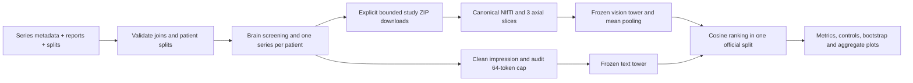

# MR-RATE MRI–Report Retrieval with MedSigLIP

A reproducible research pipeline that asks whether three slices of a brain MRI can
retrieve the study's radiology impression using frozen medical image/text embeddings.
This is a 2.5D retrieval baseline for research, with no clinical or dementia prediction claim.

The project includes a completely offline synthetic engineering demo, metadata validation,
guarded per-study downloads, native-space NIfTI preprocessing, MedSigLIP inference,
provenance caches, patient-aware evaluation, and aggregate figures.

The working configuration is restricted to **batch26**. All supporting metadata/report/label
files may be stored locally, but only batch26 metadata are read for study selection.
[config/batch26.yaml](config/batch26.yaml) pins the downloaded dataset revision. See
[docs/batch26.md](docs/batch26.md) for the batch download and next commands.

## Quick start

Run commands from this `code` directory. Python 3.11+ is supported.

Windows PowerShell:

```powershell
python -m venv .venv
.\.venv\Scripts\python.exe -m pip install -e '.[dev]'
.\.venv\Scripts\python.exe -m mrrate_vlm demo-synthetic
.\.venv\Scripts\python.exe -m pytest
.\.venv\Scripts\python.exe -m ruff check .
```

Linux/macOS:

```bash
python3 -m venv .venv
source .venv/bin/activate
python -m pip install -e '.[dev]'
python -m mrrate_vlm demo-synthetic
python -m pytest
python -m ruff check .
```

The demo writes **SYNTHETIC** fixtures, fake embeddings, QC montages and results under
`data/synthetic/`. It reconstructs known phantoms from synthetic text pattern IDs;
its retrieval numbers verify plumbing and have no empirical scientific interpretation.

See [docs/methods.md](docs/methods.md) for selection and evaluation definitions,
[docs/validation.md](docs/validation.md) for execution evidence and remaining limitations,
and [docs/sources.md](docs/sources.md) for official schema/API references.

## Real data and model setup

1. Sign in and accept the terms separately for
   [MR-RATE](https://huggingface.co/datasets/Forithmus/MR-RATE) and
   [MedSigLIP](https://huggingface.co/google/medsiglip-448).
2. Install the optional inference stack: `python -m pip install -e '.[model]'`.
   Install a PyTorch build appropriate for your hardware if needed, following
   [official PyTorch instructions](https://pytorch.org/get-started/locally/).
3. Run `hf auth login` with that account, or set `HF_TOKEN` privately in the shell.
   `.env.example` is documentation; no secrets or `.env` files are loaded automatically.

PowerShell, using the local virtual environment:

```powershell
$python = '.\.venv\Scripts\python.exe'
& $python -m pip install -e '.[model]'
& .\.venv\Scripts\hf.exe auth login
& $python -m mrrate_vlm download-metadata --batches 26 --metadata-only
& $python -m mrrate_vlm build-manifest --max-studies 30 --split validation --seed 42
& $python -m mrrate_vlm download-images --max-studies 30 --dry-run
& $python -m mrrate_vlm download-images --max-studies 30 --max-total-gb 10
& $python -m mrrate_vlm qc
& $python -m mrrate_vlm embed --max-studies 30 --split validation
& $python -m mrrate_vlm evaluate --split validation
```

Linux/macOS, after activating the environment:

```bash
python -m pip install -e '.[model]'
hf auth login
python -m mrrate_vlm download-metadata --batches 26 --metadata-only
python -m mrrate_vlm build-manifest --max-studies 30 --split validation --seed 42
python -m mrrate_vlm download-images --max-studies 30 --dry-run
python -m mrrate_vlm download-images --max-studies 30 --max-total-gb 10
python -m mrrate_vlm qc
python -m mrrate_vlm embed --max-studies 30 --split validation
python -m mrrate_vlm evaluate --split validation
```

Review `data/selection_summary.json`, `data/brain_screening_audit.csv`, and private
QC montages in `data/qc/`. Inspect anatomy and image coverage locally before interpreting
retrieval. The default keyword filter is deliberately conservative: it requires explicit
English/Turkish brain anatomy in available descriptions or report technique and vetoes spine/mixed
examinations. The official schema currently lacks guaranteed body-part labels.
If nothing passes, inspect the observed columns and adjust `brain_columns` in your YAML
using fields that actually exist. `--include-unidentified-anatomy` disables the screen;
such a run cannot be described as a brain-only experiment.

All-in-one pilots (downloads occur only when explicitly running these commands):

```powershell
.\scripts\run_pilot.ps1 -Batches '26' -MaxStudies 30 -MaxTotalGB 10 -DryRun
.\scripts\run_pilot.ps1 -Batches '26' -MaxStudies 30 -MaxTotalGB 10
```

If Windows disables local PowerShell scripts, use this process-only invocation:
`powershell.exe -NoProfile -ExecutionPolicy Bypass -File .\scripts\run_pilot.ps1 -DryRun`.
It does not change the machine's execution policy. The equivalent `python -m mrrate_vlm run`
command also works without a script.

```bash
bash scripts/run_pilot.sh 26 30 10 validation
```

Or `python -m mrrate_vlm --config config/batch26.yaml run --batches 26 --dry-run`.
Every command has `--help`; global `--config` comes before the command. Relative paths
in configuration are resolved from the current working directory. Override `data_dir`
and `results_dir` to isolate experiments. Use a commit SHA for `dataset_revision` and
`model_revision` to replay a run; online downloads resolve mutable revisions to SHA.

Use validation for development. Once choices are fixed, create a separate test config
with `split: test`, a fresh `data_dir` and `results_dir`, then run once. No training or
fine-tuning occurs. All reports used as candidates come from the same official split.

## Data and pipeline

| File / unit | Keys and purpose |
|---|---|
| `metadata/batchXX_metadata.csv` / series | `patient_uid`, `study_uid`, `series_id`; filename defines physical `source_batch` |
| `reports/batchXX_reports.csv` / study | `study_uid`; cleaned `impression`, optional explicit findings fallback |
| `splits.csv` / study | `study_uid`, `patient_uid`, official patient-disjoint `split` |
| `mri/batchXX/<study_uid>.zip` / study | Selected `img/<study_uid>_<series_id>.nii.gz` inside study folder |



Default series priority is **FLAIR → T2w → T1w**, preferring axial acquisition,
then lower numeric `SeriesNumber`, then lexical `series_id`. A seeded SHA-256 ordering
selects one study per patient and caps the chosen split. Sequence contrast does not
identify anatomy. The report describes the entire study, so its pairing to a single
series is weak. Source batch is never inferred from `splits.batch_id`, which represents
the patient's first batch.

Grayscale MRI is robustly windowed and repeated into RGB channels. The official
processor performs resizing. Slice embeddings are individually unit normalized,
mean pooled and normalized again. The text tower uses the actual model tokenizer,
fixed-length padding, and a maximum of 64 tokens including special tokens. Token
counts and truncation are saved without report text in `data/embeddings/qc_summary.json`.

## Results and interpretation

**No real MR-RATE / MedSigLIP benchmark has been run in this repository.** A completed
authorized run writes measured results; synthetic outputs are never evidence of
real model performance.

`results/metrics.json` contains actual N, R@1, R@5 (only N ≥ 5), MRR, median rank,
random expectation, a seeded deranged-pair control, patient bootstrap 95% intervals,
duplicate/near-duplicate diagnostics, duplicate-free sensitivity, and subgroups only
when their query counts reach the configured minimum. Tied scores receive average ranks.
`result_table.md`, hashed-ID-only `retrieval_examples.csv`, aggregate metric bars,
rank histogram, and `limitations.md` are generated alongside it. Inspect best and worst
hashed cases against private local QC; reports and patient images are never exported
to the results directory. Keep even hashed examples private until terms review.

Intervals are descriptive query bootstrap intervals conditional on the fixed candidate
pool. Duplicate report text can penalize strict matching even for equivalent impressions.
Small convenience subsets, domain shift, truncated text, uncertain anatomical screening,
and study-vs-series pairing limit interpretation. No significance or diagnostic claims.

## Resource and privacy practices

The normal pilot downloads explicit individual study ZIPs, with default caps of 30 studies and
10 decimal GB across the selected compressed ZIPs. Authorized HEAD requests estimate all
selected sizes before any MRI download; unknown sizes fail closed. Dry-run is fully
offline and reports paths with sizes unknown. Downloads over the cap require changing
the cap explicitly. Validated ZIP caches avoid repeated downloads. Metadata-only commands
never load the model or MRI ZIPs. The model checkpoint itself takes additional disk space,
outside the image cap; GPU inference is preferable and CPU inference can be slow.
No GPU memory or runtime guarantees are assumed. Embedding cache provenance includes
input ZIP SHA-256, row/config/code hashes, model/data revisions, preprocessing and environment.

`download-batch` is a separate explicit opt-in for all ZIPs of one named batch plus all
non-MRI repository files. It lists exact remote sizes first and enforces the same size cap
across both MRI and supporting files. It never fetches another MRI batch. Completed files
are checked against remote SHA-256 hashes where available, and MRI ZIPs also pass CRC
validation. An interrupted run can resume using the Hugging Face local cache. This batch
download does not load or download model weights. `--dry-run` stays offline;
`--inspect-remote` queries file sizes without downloading dataset files.

`data/`, `cache/`, generated `results/`, raw CSVs, NIfTIs, tokens, checkpoints and embeddings
are excluded by `.gitignore`. Keep custom output locations private too. The code license
does not grant dataset/model rights: MR-RATE has CC BY-NC-SA 4.0 plus additional gated
privacy/redistribution conditions; MedSigLIP has separate Health AI Developer Foundations
terms. Do not publish raw data or assume hashing removes all privacy obligations.

## Repository

```text
config/default.yaml           reproducible pilot choices
src/mrrate_vlm/                dataset, download, imaging, embed, retrieval, evaluation, CLI
tests/                        offline fixtures, leakage/safety/metric/API checks
scripts/run_pilot.{ps1,sh}     complete pilot entry points
docs/                         methods, sources, validation
MR_RATE_Codex_Handoff/         local handoff documents (ignored by Git)
data/                         ignored local inputs and derived artifacts
results/                      ignored aggregate run outputs
```

Dataset citation and conditions: [MR-RATE dataset card](https://huggingface.co/datasets/Forithmus/MR-RATE).
Model citation: Sellergren et al., *MedGemma Technical Report* (2025),
[arXiv:2507.05201](https://arxiv.org/abs/2507.05201), as requested by the
[MedSigLIP card](https://huggingface.co/google/medsiglip-448).
